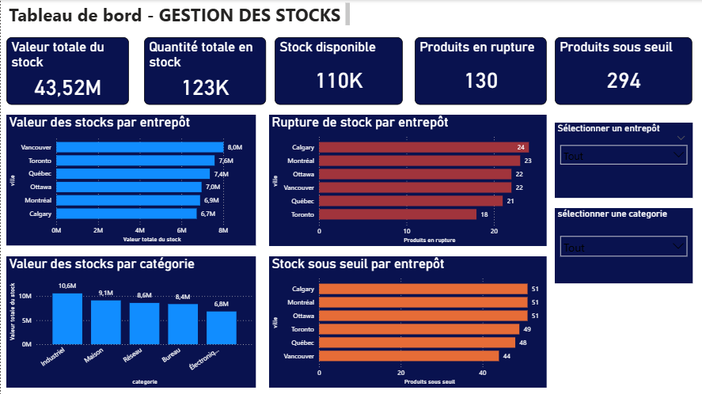
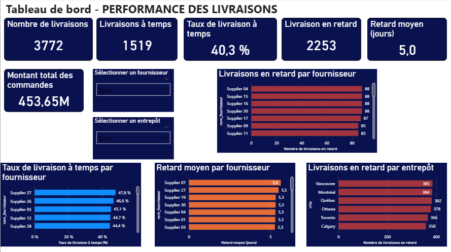
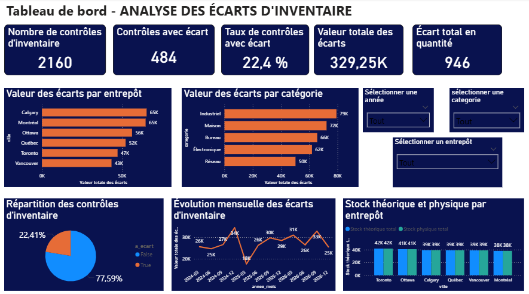

# Inventory Analytics | SQL Server | SSIS | Power BI

## Présentation du projet

**Inventory Analytics** est un projet d'intelligence d'affaires (Business Intelligence) consacré à l'analyse des stocks, à la performance des livraisons et au contrôle des écarts d'inventaire.

L'objectif est de transformer des données opérationnelles en informations fiables et exploitables pour améliorer la prise de décision.

Le projet couvre plusieurs étapes d'une solution BI : conception d'un entrepôt de données, développement de processus ETL, modélisation dimensionnelle et création de tableaux de bord interactifs.

## Objectifs du projet

* Analyser les quantités et la valeur des stocks.
* Identifier les ruptures et les stocks sous le seuil de réapprovisionnement.
* Mesurer la performance des livraisons et des fournisseurs.
* Identifier les retards de livraison.
* Comparer les stocks théoriques et physiques.
* Analyser les écarts d'inventaire par entrepôt et par catégorie de produits.

##  Technologies utilisées

| Technologie        | Utilisation                                              |
| ------------------ | -------------------------------------------------------- |
| SQL Server         | Gestion des bases de données et de l'entrepôt de données |
| T-SQL              | Création des tables, requêtes et procédures stockées     |
| SSIS               | Extraction, transformation et chargement des données     |
| Visual Studio 2022 | Développement des packages SSIS                          |
| Power BI           | Conception des tableaux de bord                          |
| Power Query        | Préparation des données                                  |
| DAX                | Création des indicateurs de performance                  |

## Architecture BI

Le projet repose sur l'architecture suivante :

**Base opérationnelle SQL Server → ETL SSIS → Data Warehouse SQL Server → Power BI**

L'entrepôt de données `Inventory_DW` comprend cinq dimensions et quatre tables de faits.

### Dimensions

* `Dim_Date`
* `Dim_Produit`
* `Dim_Entrepot`
* `Dim_Fournisseur`
* `Dim_Type_Mouvement`

### Tables de faits

* `Fact_Stock_Courant`
* `Fact_Mouvement_Stock`
* `Fact_Livraison`
* `Fact_Inventaire`

## Processus ETL

Deux packages SSIS ont été développés :

**01_Chargement_Dimensions.dtsx**

Chargement des dimensions de l'entrepôt de données.

**02_Chargement_faits.dtsx**

Chargement des tables de faits utilisées pour les analyses.

Les packages exécutent des procédures stockées SQL Server et permettent de structurer le processus d'alimentation de l'entrepôt.

## Tableaux de bord Power BI

### 1. Gestion des stocks

Ce tableau de bord permet de suivre la valeur des stocks, les quantités disponibles, les ruptures et les produits sous le seuil de réapprovisionnement.

**Principaux indicateurs :**

* Valeur totale du stock : 43,52 M
* Quantité totale en stock : 123 K
* Stock disponible : 110 K
* Produits en rupture : 130
* Produits sous seuil : 294

### 2. Performance des livraisons

Ce tableau de bord permet d'évaluer les délais de livraison et la performance des fournisseurs.

**Principaux indicateurs :**

* Nombre de livraisons : 3 772
* Livraisons à temps : 1 519
* Taux de livraison à temps : 40,3 %
* Livraisons en retard : 2 253
* Retard moyen : 5 jours

### 3. Analyse des écarts d'inventaire

Ce tableau de bord permet de comparer les stocks théoriques et physiques et d'identifier les écarts.

**Principaux indicateurs :**

* Nombre de contrôles : 2 160
* Contrôles avec écart : 484
* Taux de contrôles avec écart : 22,4 %
* Valeur absolue cumulée des écarts : 329,25 K
* Écart absolu cumulé en quantité : 946 unités

## Compétences démontrées

Ce projet met en évidence les compétences suivantes :

* Analyse et préparation des données.
* Développement SQL et procédures stockées.
* Conception d'un entrepôt de données.
* Modélisation dimensionnelle.
* Développement de processus ETL avec SSIS.
* Création de mesures DAX.
* Visualisation et analyse des données avec Power BI.
* Conception de tableaux de bord interactifs.
* Analyse des indicateurs de performance.

## Contenu du dépôt

Le dépôt contient les scripts SQL, les packages SSIS, le rapport Power BI et les captures d'écran des tableaux de bord.

## Conclusion

Inventory Analytics illustre la mise en œuvre d'une solution décisionnelle complète, depuis la préparation et l'intégration des données jusqu'à leur analyse et leur visualisation dans Power BI.

Le projet démontre l'utilisation complémentaire de SQL Server, SSIS et Power BI pour répondre à des besoins de suivi opérationnel et d'aide à la décision.

## Aperçu des tableaux de bord Power BI

### 1. Gestion des stocks

### 2. Performance des livraisons

### 3. Analyse des écarts d'inventaire

